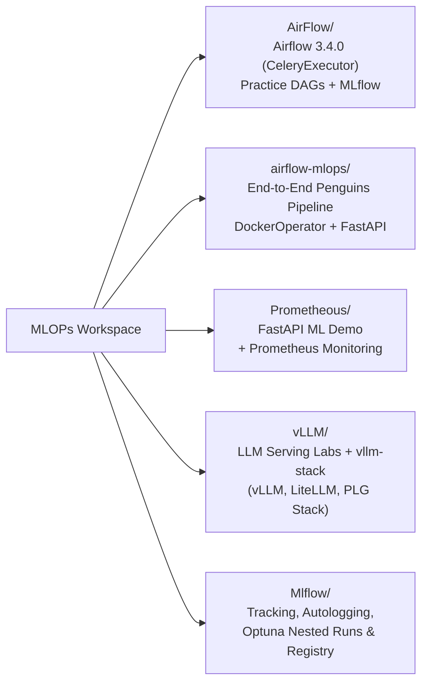

# MLOps & LLMOps Practice Repository

Kho mã nguồn tổng hợp các dự án và bài lab thực hành về **MLOps** và **LLMOps**, bao gồm điều phối quy trình dữ liệu/ML (**Apache Airflow 3**), theo dõi thí nghiệm (**MLflow**), phục vụ mô hình (**FastAPI**, **vLLM**), cổng điều phối AI (**LiteLLM**), và giám sát hệ thống (**Prometheus, Grafana, Loki, Alloy**).

---

## 1. Tổng quan kiến trúc các module



| Thư mục | Chủ đề chính | Công nghệ sử dụng | Tài liệu chi tiết |
| :--- | :--- | :--- | :--- |
| [`AirFlow/`](./AirFlow) | Thực hành các tính năng cốt lõi của Airflow 3 & tích hợp MLflow | Apache Airflow 3.4.0 (`CeleryExecutor`), PostgreSQL 16, Redis 7.2, MLflow, Scikit-learn, FastAPI | Mục [4.1](#41-airflow--thực-hành-apache-airflow-340--mlflow) |
| [`airflow-mlops/`](./airflow-mlops) | Hệ thống MLOps end-to-end phân loại Penguins (train song song, Champion vs Challenger, hot-reload) | Apache Airflow 3.4.0 (`LocalExecutor`), `DockerOperator`, Scikit-learn, FastAPI, Docker Shared Volume | [`airflow-mlops/README.md`](./airflow-mlops/README.md) |
| [`Prometheous/`](./Prometheous) | Instrument ML Inference API và thu thập metrics bằng Prometheus | FastAPI, `prometheus-client`, Prometheus `v3.13.1`, Docker Compose | Mục [4.3](#43-prometheous--giám-sát-ml-api-với-prometheus) |
| [`vLLM/`](./vLLM) | Thực hành LLM Serving, Benchmarking (TTFT/TPOT/E2E) và triển khai AI Gateway + Observability | vLLM, OpenAI SDK, LiteLLM Proxy, PostgreSQL 17, Prometheus, Grafana, Loki, Alloy | [`vLLM/README.md`](./vLLM/README.md) |
| [`Mlflow/`](./Mlflow) | Thực hành MLflow độc lập: Tracking, Autologging, Optuna Nested Runs & Model Registry (Aliases) | MLflow 3, Scikit-learn, Optuna, SQLite | Mục [4.5](#45-mlflow--thực-hành-mlflow-tracking-optuna--model-registry) |

> **Lưu ý về Git:** Thư mục `airflow-mlops/` hiện được khai báo trong `.gitignore` của repository gốc và được quản lý như một sub-project độc lập.

---

## 2. Cấu trúc thư mục toàn dự án

```text
MLOPs/
├── README.md                              # Tài liệu tổng quan toàn bộ source (file này)
├── .gitignore
├── AirFlow/                               # Lab Apache Airflow 3.4.0 (CeleryExecutor)
│   ├── docker-compose.yaml                # Cụm Airflow + Postgres + Redis (+ Flower/CLI profiles)
│   ├── config/airflow.cfg
│   └── dags/
│       ├── hello_airflow.py               # DAG cơ bản kiểm tra môi trường
│       ├── taskflow.py                    # TaskFlow API & truyền dữ liệu giữa các task
│       ├── branching.py                   # Rẽ nhánh có điều kiện với @task.branch
│       ├── mapping.py                     # Dynamic Task Mapping (.expand)
│       ├── retry.py                       # Retry, exponential backoff & execution timeout
│       ├── trigger_rules.py               # Trigger rule (all_done) cho task cleanup
│       ├── Xcom_varriables_connections.py # Sử dụng XCom, Variable và Connection
│       ├── experiment_tracking.py         # Train Iris RandomForest & log lên MLflow
│       └── inference_api.py               # FastAPI nạp model trực tiếp từ MLflow run
├── airflow-mlops/                         # Dự án MLOps End-to-End (Penguins Classification)
│   ├── README.md                          # Hướng dẫn chi tiết riêng cho dự án
│   ├── docker-compose.yaml                # Cụm Airflow 3.4.0 (LocalExecutor)
│   ├── docker-compose.mlops.yaml          # Service ml-api + shared volume & network
│   ├── airflow/Dockerfile                 # Image Airflow cài providers-docker & providers-http
│   ├── dags/penguins_ml_pipeline.py       # DAG tự động xử lý, train 3 model, so sánh & reload
│   └── ml/                                # Source ML & FastAPI serving
│       ├── Dockerfile
│       ├── requirements.txt
│       ├── data_processing.py
│       ├── training.py
│       └── api.py
├── Prometheous/                           # Lab giám sát ML Inference API với Prometheus
│   ├── Dockerfile
│   ├── docker-compose.yml                 # FastAPI ml-api + Prometheus v3.13.1
│   ├── requirements.txt
│   ├── app/main.py                        # FastAPI expose /predict và /metrics
│   └── prometheus/
│       ├── prometheus.yml                 # Cấu hình scrape interval 5s
│       └── rules.yml                      # File khai báo recording/alerting rules
├── vLLM/                                  # Lab vLLM & Production AI Gateway Stack
│   ├── README.md                          # Hướng dẫn chi tiết riêng cho vLLM
│   ├── requirements.txt
│   ├── tokenization.py                    # Lab Tokenizer & chat template overhead
│   ├── demo.py                            # Demo gọi Groq API qua OpenAI SDK
│   ├── lesson_1_2/                        # Suy luận offline (offline_chat.py, offline_batch.py)
│   ├── lesson_1_3/                        # Client requests & streaming (client_requests.py, client_stream.py)
│   ├── lesson_1_4/                        # Benchmark tải (load_test.py: TTFT, TPOT, E2E)
│   └── vllm-stack/                        # Docker Compose full stack
│       ├── compose.yaml                   # vLLM, LiteLLM, Postgres, Prometheus, Grafana, Loki, Alloy
│       ├── litellm/config.yaml
│       ├── prometheus/prometheus.yml
│       ├── loki/loki.yaml
│       ├── alloy/config.alloy
│       └── grafana/provisioning/datasources/
└── Mlflow/                                # Lab MLflow độc lập (Tracking, Optuna, Model Registry)
    ├── test.py                            # Kiểm tra kết nối MLflow Tracking Server
    ├── tracking_demo.py                   # Log params, metrics & tags thủ công (Breast Cancer)
    ├── autologging.py                     # Thực hành mlflow.autolog() trên Iris RandomForest
    ├── optimization.py                    # Tối ưu siêu tham số với Optuna (multi-objective) + Nested Runs
    ├── registry_v1.py                     # Đăng ký model v1 (LogisticRegression) & gắn alias @prod
    └── registry_v2.py                     # So sánh RandomForest tốt nhất với @prod & tự động promote
```

---

## 3. Yêu cầu môi trường & Quy hoạch cổng (Ports)

### Yêu cầu chung
- **Docker** và **Docker Compose v2**
- **Python 3.12+** (cho các script chạy cục bộ trong `vLLM/` hoặc kiểm thử API)
- **NVIDIA GPU + NVIDIA Container Toolkit** (chỉ bắt buộc khi chạy `vLLM`)

### Bảng tổng hợp cổng dịch vụ

| Module | Dịch vụ | Cổng Host | Ghi chú |
| :--- | :--- | :---: | :--- |
| `AirFlow` | Airflow API Server / Web UI | `8080` | Mặc định `airflow` / `airflow` |
| `AirFlow` | Celery Flower *(tùy chọn)* | `5555` | Bật bằng `--profile flower` |
| `airflow-mlops` | Airflow 3 UI | `8080` | `SimpleAuthManager` (`ALL_ADMINS=True`) |
| `airflow-mlops` | FastAPI ML Serving (`ml-api`) | `8000` | Swagger UI tại `/docs` |
| `Prometheous` | FastAPI ML Demo (`ml-api`) | `8000` | Endpoints: `/`, `/predict`, `/metrics` |
| `Prometheous` | Prometheus UI | `9090` | Scrape `ml-api:8000/metrics` mỗi 5s |
| `vLLM/vllm-stack` | LiteLLM Gateway & Admin UI | `4000` | Admin UI tại `/ui` |
| `vLLM/vllm-stack` | Grafana | `3000` | Pre-provisioned Prometheus & Loki |
| `vLLM/vllm-stack` | Prometheus | `9090` | Scrape vLLM (`:8000`) & LiteLLM (`:4000`) |
| `vLLM/vllm-stack` | Loki | `3100` | Thu nhận Docker logs từ Grafana Alloy |
| `Mlflow` | MLflow Tracking Server & UI | `5000` | Backend SQLite (`mlflow.db`) & `./mlartifacts` |

> **Cảnh báo trùng cổng:** Một số module dùng chung cổng **`8000`**, **`8080`** hoặc **`9090`**. Hãy `docker compose down` stack cũ trước khi khởi chạy stack khác cùng cổng.

---

## 4. Hướng dẫn chi tiết từng module

### 4.1. `AirFlow/` — Thực hành Apache Airflow 3.4.0 & MLflow

Cụm Airflow 3.4.0 chạy bằng **CeleryExecutor** (`postgres:16`, `redis:7.2-bookworm`, `airflow-apiserver`, `airflow-scheduler`, `airflow-dag-processor`, `airflow-worker`, `airflow-triggerer`) kèm bộ DAG thực hành theo từng chủ đề:

| File | `dag_id` | Nội dung thực hành |
| :--- | :--- | :--- |
| `hello_airflow.py` | `hello_airflow` | Khởi tạo DAG cơ bản bằng `airflow.sdk` (`@dag`, `@task`). |
| `taskflow.py` | `task-flow` | Chuỗi task tính accuracy từ dự đoán mẫu và lưu ra `/tmp/accuracy.txt`. |
| `branching.py` | `branching` | Rẽ nhánh bằng `@task.branch`: nếu `f1_score > 0.9` thì `deploy_model`, ngược lại `reject_model`. |
| `mapping.py` | `mapping` | Dynamic Task Mapping với `process_data.expand(...)` và tổng hợp số dòng ở bước `aggregate_data`. |
| `retry.py` | `retry-dag` | Cấu hình `retries=5`, `retry_delay=5s`, `retry_exponential_backoff=True`, `execution_timeout=1m` (mô phỏng lỗi 2 lần đầu, thành công ở lần thử 3). |
| `trigger_rules.py` | `trigger-rules` | Minh họa `trigger_rule="all_done"` để `cleanup` luôn chạy kể cả khi `task_b` thất bại. |
| `Xcom_varriables_connections.py` | `xom-varriables-connections` | Đọc `Connection("mlflow_api")`, truyền metrics qua XCom và so sánh với `Variable("min_deploy_f1", default=0.85)`. |
| `experiment_tracking.py` | `experiment_tracking` | Load dữ liệu Iris, chia train/test, huấn luyện `RandomForestClassifier` (`n_estimators` = `25, 50, 100`) và log params/metrics/model vào MLflow (`sqlite:////opt/airflow/dags/mlflow.db`, experiment `iris-v3`). |
| `inference_api.py` | *(FastAPI app)* | Ứng dụng FastAPI (`/health`, `/predict`) tải model sklearn trực tiếp từ MLflow run trong `dags/mlflow.db`. |

**Khởi chạy cụm Airflow:**

```bash
cd AirFlow
# Tạo/kiểm tra file .env (AIRFLOW_UID, FERNET_KEY, _AIRFLOW_WWW_USER_USERNAME, _AIRFLOW_WWW_USER_PASSWORD)
docker compose up -d

# (Tùy chọn) Bật thêm Celery Flower tại http://localhost:5555
docker compose --profile flower up -d
```

Truy cập giao diện Airflow tại `http://localhost:8080`.

---

### 4.2. `airflow-mlops/` — End-to-End MLOps Pipeline (Penguins Classification)

Hệ thống MLOps tự động chạy định kỳ (`*/5 * * * *`) theo mô hình **Champion vs Challenger**:
1. **`process_data` (`DockerOperator`)**: Lấy thêm batch 100 dòng vào `raw.csv` và làm sạch thành `processed.csv`.
2. **Train song song (`DockerOperator` x3)**: Huấn luyện 3 mô hình `random_forest`, `decision_tree`, `logistic_regression` trong các container tách biệt.
3. **`check_model` (`@task.branch`)**: So sánh `accuracy` tốt nhất với mô hình production hiện tại (`prod_metrics.json`).
4. **`promote_and_reload` / `skip_deploy`**: Nếu mô hình mới tốt hơn hoặc bằng, cập nhật `prod_model.joblib` trên shared volume `/opt/shared` và gọi `POST http://ml-api:8000/reload` để FastAPI hot-reload không cần restart.

**Khởi chạy nhanh:**

```bash
cd airflow-mlops
docker compose -f docker-compose.yaml -f docker-compose.mlops.yaml up -d --build
```

Xem đầy đủ cấu hình `.env`, sơ đồ volume và các lệnh test tại [`airflow-mlops/README.md`](./airflow-mlops/README.md).

---

### 4.3. `Prometheous/` — Giám sát ML API với Prometheus

Demo dịch vụ suy luận FastAPI (`demo-logistic-v1`) tích hợp `prometheus-client` và máy chủ Prometheus `v3.13.1` thu thập metrics mỗi 5 giây.

**Các metrics được expose tại `GET /metrics`:**
- `ml_inference_requests_total` (`Counter`, labels: `model`, `status`): Tổng số request `success` / `error`.
- `ml_inference_in_progress` (`Gauge`, labels: `model`): Số request suy luận đang xử lý đồng thời.
- `ml_inference_duration_seconds` (`Histogram`, labels: `model`): Phân bố độ trễ suy luận.
- `ml_prediction_score` (`Histogram`, labels: `model`): Phân bố xác suất dự đoán (sigmoid score).
- `ml_model_info` (`Info`): Metadata tên và phiên bản mô hình.

**Khởi chạy & kiểm thử:**

```bash
cd Prometheous
docker compose up -d --build
```

```bash
# 1. Gọi dự đoán thành công
curl -X POST http://localhost:8000/predict \
  -H "Content-Type: application/json" \
  -d '{"value": 2.5}'

# 2. Mô phỏng lỗi model (trả về HTTP 500 và tăng counter status="error")
curl -X POST http://localhost:8000/predict \
  -H "Content-Type: application/json" \
  -d '{"value": -999}'

# 3. Xem raw metrics
curl http://localhost:8000/metrics
```

Truy cập Prometheus UI tại `http://localhost:9090` để truy vấn PromQL. Có thể bổ sung alerting/recording rules vào `Prometheous/prometheus/rules.yml`.

---

### 4.4. `vLLM/` — LLM Serving, AI Gateway & Observability

Bao gồm 2 phần chính:
- **Standalone Labs (`vLLM/`)**:
  - `tokenization.py`: Kiểm tra mã hóa token và chi phí token của chat template (`Qwen/Qwen3-0.6B`).
  - `demo.py`: Thử nghiệm OpenAI SDK kết nối tới Groq (`openai/gpt-oss-20b`).
  - `lesson_1_2/`: Suy luận offline đơn lẻ (`offline_chat.py`) và theo batch (`offline_batch.py`) với `vllm.LLM`.
  - `lesson_1_3/`: Gọi vLLM server qua HTTP `requests` (`client_requests.py`) và streaming qua OpenAI SDK (`client_stream.py`).
  - `lesson_1_4/load_test.py`: Công cụ load test bất đồng bộ (`--requests`, `--concurrency`) tới LiteLLM (`http://localhost:4000/v1`), báo cáo Request/Output Throughput, Mean & P95 của **TTFT**, **TPOT** và **E2E latency**.
- **Production Stack (`vLLM/vllm-stack/`)**:
  - Triển khai **vLLM (GPU)** + **LiteLLM Proxy** (Virtual Keys, Budgets, RPM/TPM, Routing local/Groq) + **PostgreSQL 17** + **Prometheus** + **Grafana** + **Loki** + **Grafana Alloy**.

**Khởi chạy nhanh stack:**

```bash
cd vLLM/vllm-stack
docker compose up -d
```

Xem sơ đồ kiến trúc, cấu hình `.env` và hướng dẫn chi tiết tại [`vLLM/README.md`](./vLLM/README.md).

---

### 4.5. `Mlflow/` — Thực hành MLflow Tracking, Optuna & Model Registry

Bộ bài thực hành độc lập sử dụng **MLflow 3**, **Scikit-learn** và **Optuna**, kết nối tới MLflow Tracking Server cục bộ (SQLite backend + local artifact store):

| File | Experiment | Nội dung thực hành |
| :--- | :--- | :--- |
| `test.py` | `demo` | Kiểm tra kết nối tới MLflow Server (`http://127.0.0.1:5000`), log `param`/`metric` cơ bản và in `run_id`, `artifact_uri`. |
| `tracking_demo.py` | `breast-cancer-classification` | Huấn luyện `LogisticRegression` với các giá trị `C` (`0.01, 0.1, 1.0`), log `params`, `metrics` (`accuracy`, `f1_score`) và `tag` thủ công. |
| `autologging.py` | `use-autolog` | Minh họa `mlflow.autolog()` tự động ghi lại params, metrics, model và artifacts khi huấn luyện `RandomForestClassifier` trên bộ dữ liệu Iris. |
| `optimization.py` | `Cancer-classification-optimization` | Tối ưu đa mục tiêu (`f1`, `recall`) bằng **Optuna** kết hợp **Nested Runs** (`nested=True`), sau đó refit `best_model` và log kèm `skops_trusted_types` vào run cha. |
| `registry_v1.py` | `Registry-Demo` | Huấn luyện `LogisticRegression`, log model kèm `input_example` + `signature`, đăng ký vào Model Registry (`breast-cancer-model`), gắn tags, description và alias `@prod`. |
| `registry_v2.py` | `Registry-Demo` | Thử nghiệm `RandomForestClassifier` (`n_estimators` = `50, 100, 200`), chọn model tốt nhất, nạp `models:/breast-cancer-model@prod` bằng `pyfunc` để so sánh và tự động đăng ký/chuyển alias `@prod` nếu tốt hơn hoặc bằng. |

**Khởi chạy MLflow Tracking Server & thực hành:**

```bash
cd Mlflow

# 1. Khởi chạy MLflow Server (UI tại http://127.0.0.1:5000)
mlflow server \
  --backend-store-uri sqlite:///mlflow.db \
  --artifacts-destination ./mlartifacts \
  --host 127.0.0.1 \
  --port 5000

# 2. Chạy các script thực hành (ở một terminal khác)
python tracking_demo.py
python autologging.py
python optimization.py

# 3. Thực hành Model Registry (chạy v1 trước để tạo @prod, sau đó chạy v2 để so sánh & promote)
python registry_v1.py
python registry_v2.py
```

*(Các file dữ liệu sinh ra như `mlflow.db`, `mlartifacts/`, `mlruns/` đã được loại trừ trong `.gitignore`.)*

Ngoài ra, các ví dụ tích hợp MLflow cùng Airflow và FastAPI nằm tại:
- [`AirFlow/dags/experiment_tracking.py`](./AirFlow/dags/experiment_tracking.py)
- [`AirFlow/dags/inference_api.py`](./AirFlow/dags/inference_api.py)

---

## 5. Lưu ý bảo mật

- Toàn bộ file `.env` đã được loại trừ trong `.gitignore`; hãy cấu hình biến môi trường cục bộ trước khi chạy từng stack.
- Trước khi đẩy mã nguồn lên kho lưu trữ công khai, hãy kiểm tra và chuyển các API key hard-coded (ví dụ trong `vLLM/demo.py` hoặc key mẫu trong `vLLM/lesson_1_4/load_test.py`) sang biến môi trường (`os.getenv(...)`).
